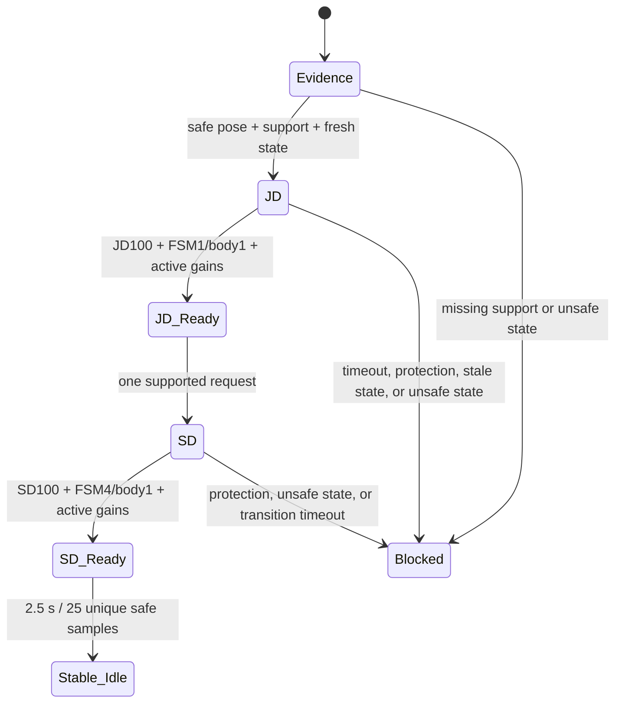

# X2 Startup Supervisor Research Workflow

Status: Issue #80 research workflow. This is a fail-closed development procedure, not
a production robot operating manual or a substitute for AgiBot's recovery procedure.

The companion pure policy tool is
`scripts/research/issue80_x2_startup_supervisor.py`. It only converts observed
evidence into permitted next operations. It does not import MuJoCo or ROS, issue
services, publish commands, write qpos, call Reset, or actuate hardware.

Its operation contracts use the installed AimDK names without invoking them:
JD/SD/LD map to /aimdk_5Fmsgs/srv/SetMcAction; input-source management maps to
/aimdk_5Fmsgs/srv/SetMcInputSource; bounded and zero locomotion commands map to
/aima/mc/locomotion/velocity. A returned contract is permission for a separately
reviewed executor to attempt its next observed gate, never an automatic action.

Reference contracts: [AimDK motion-mode switching](https://x2-aimdk.agibot.com/zh-cn/latest/Interface/control_mod/modeswitch.html),
[AimDK MC input-source control](https://x2-aimdk.agibot.com/zh-cn/latest/Interface/control_mod/MC_control.html),
and [MuJoCo sensor reference](https://mujoco.readthedocs.io/en/latest/XMLreference.html).

## State-machine boundary



A mode-service acknowledgement is not a state transition. The supervisor keeps
service acceptance, transition, mode readback, physical posture, and continuous
hold as separate gates.

## Simulation startup

The normal simulation path begins with a **verified physically valid standing
configuration before stepping**. Its input is an initial configuration artifact
that proves the expected root pose, support geometry and contact prerequisites;
the supervisor neither invokes the MuJoCo GUI Reset nor writes qpos.

1. Verify the scene/model hash and the standing initial configuration.
2. Verify initial support with a declared evidence source.
3. Start simulator, MC and telemetry.
4. Require fresh, strictly advancing state and safe pose.
5. Request JD only after the above gate.
6. Require JD ready, then request SD.
7. Require SD ready and the stable hold.

The existing Reset runner remains a diagnostic/recovery test. A GUI Reset is an
episode boundary, not an operational stand-up procedure.

## Real-robot startup

The real-robot path never contains Reset, qpos writes, root teleportation or
automatic recovery from a lying/fallen/unsupported/unknown posture.

1. Observe native MC startup state and freshness.
2. Require an official supported physical stand-up or assisted recovery procedure,
   completed under the operator prerequisites applicable to the robot.
3. Require operator confirmation, feet support evidence, joint readiness and safe
   body state.
4. Only then allow JD, followed by the same observed JD-ready and SD-ready gates.
5. Require the 2.5-second measured hold before declaring stable idle.

When any support, posture or recovery evidence is unknown, the only allowed
operation is observation or operator/supported-recovery request. It must not
issue JD or SD.

## Navigation lifecycle

SD is the desired stable idle state. A future navigation executor must follow:

```text
STABLE_IDLE
  -> registered + arbitrated source
  -> verified LD
  -> bounded nonzero command + measured physical movement
  -> zero command
  -> measured physical stop
  -> source release
  -> verified SD stable idle
```

A published zero command alone never proves physical stopping. The supervisor
therefore refuses source release until physical stop evidence is supplied.

## Current RAICOM evidence and limitations

The 2026-10-26 JD-to-SD trial reset successfully, achieved observed JD readiness
in 0.300726 s, and received an accepted SD response. At 0.209026 m/s planar
root speed, 41.990 ms after SD request, the unchanged 0.20 m/s gate stopped the
episode. Root height, tilt and source joint limits were still inside their gates,
but no SD-ready or 2.5-second hold was established.

The compiled X2 XML defines `body-linear-vel` as MuJoCo `velocimeter` on
`imu_0`, which is a local-frame sensor. The proprietary publisher mapping
from that sensor to `Odometry.twist` is unavailable. The planar speed norm is
invariant to a yaw-only frame rotation, and the saved pelvis pose also moved
about 60.94 mm in world +Y from first upright sample to the speed gate, so this
cannot be dismissed as a coordinate-label artifact. Axis-specific interpretation
remains unverified.

The configured foot-contact sensor lists are commented out. Offline
`mj_forward` reconstruction of the saved speed-gate pose finds 16 ankle-roll
geom/floor contact candidates with world +Z normals, −0.05 to −0.39 mm
distances and compiled friction starting with [1, 1]. It is not a replay of
contact impulses: no live normal-force, contact impulse or foot-support stream
was captured. The first-upright reconstruction has no foot candidates, but its
odom and leg state are asynchronously sampled, so it cannot prove flight.

Room timestep remains 0.002 s while the native baseline is 0.001 s. MC leg
commands are configured at 500 Hz and common status at 10 Hz. These facts, plus
saved missed-wakeup warnings, are a timing compatibility gap; they do not alone
identify the speed-rise cause.

## Proposed next bounded standing experiment

Requires separate authorization. Before JD, expose or record a read-only support
signal from the existing simulator/model-manager contact data and record a
world-frame pelvis velocity or independent finite-difference pose estimate.
Start only from a verified supported standing configuration, preserve all current
limits, send JD then SD once each, and observe the same 2.5-second hold. Do not
raise the speed threshold, alter friction/gains/torque, modify the model, or use
GUI Reset as normal startup.

## Prototype disposition

`issue80_x2_startup_supervisor.py` and its tests are **KEEP-AS-TOOL** for
Issue #80 startup validation. They are not production runtime, hardware
recovery code, or authorization to run an unreviewed backend executor.

